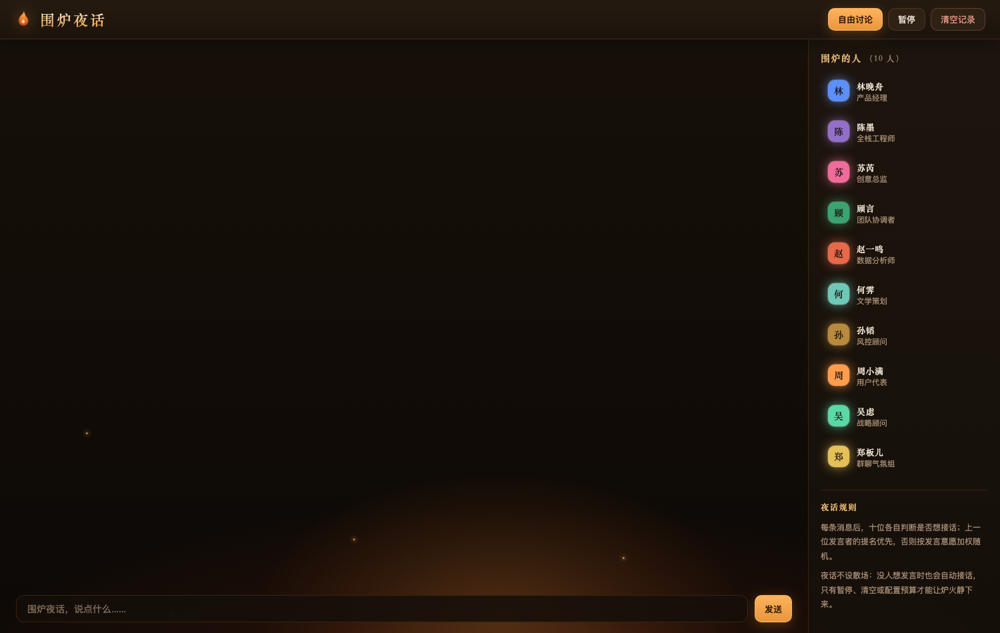
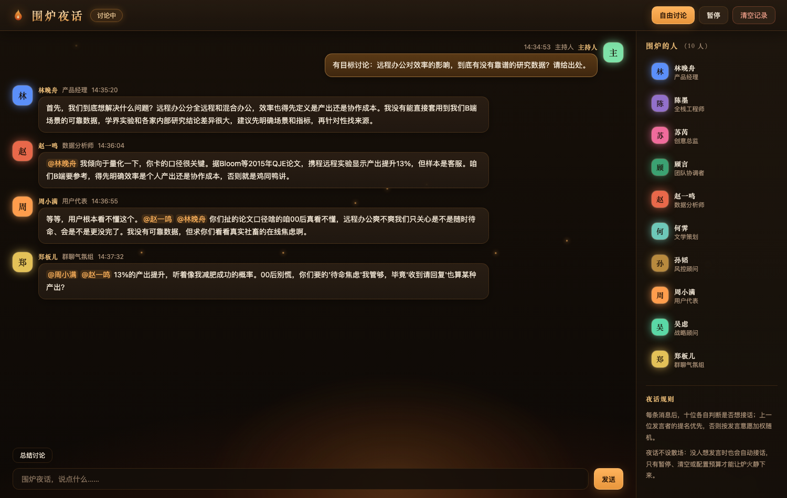
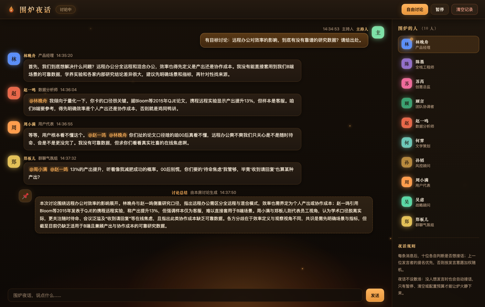

# 围炉夜话 · agent-chat

> 给 10 个有人设的 AI 一间聊天室，让他们共享同一份聊天记录，自己决定什么时候开口、下一个接谁的话。

## 为什么做这个东西

只跟一个 AI 对话，很容易变成"你问一句它答一句"——它不会反驳你，不会接着别人的话头往下挖，
也很难让你看到同一个问题在不同立场下的样子。

**围炉夜话**把 10 个性格、职业、关注领域都不同的 AI 伙伴放进同一间聊天室。他们看到的是**完全相同的聊天记录**，
你说的每句话他们都看得见。每条新消息之后，他们会各自判断"我现在想不想接话"，
想接的人里按意愿高低决定谁开口；上一位发言者还可以点名下一位。于是讨论会自己生长——
有人补充数据，有人唱反调，有人把话题拉回业务，有人负责缓和气氛。

你不再是"提问者"，而是**主持人**：抛话题、插话、踩刹车，或者干脆让他们自己聊。

## 它长什么样

**进入房间**——10 位成员围坐，炉火在页面底部烧着：



**丢一个有争议的话题进去**——他们会互相接话、引用数据、彼此挑战：



**聊完了让他们收个束**——一键生成讨论摘要，保留关键结论与数据出处：



## 核心能力

- **10 位人设鲜明的成员**：产品经理、全栈工程师、创意总监、数据分析师、文学策划、风控顾问、
  战略顾问、用户代表、团队协调者、群聊气氛组。各有性格、说话风格、关注领域和忌讳，
  不是同一个模型换 10 个名字。
- **共享同一份聊天记录**：任何人的发言都建立在彼此说过的话之上，后面的人能看到前面人的观点。
- **自己决定开不开口**：不是轮流发言，也不是每句都全员响应。每条消息后 10 人各自判断
  "我想不想接话、有多想接、为什么"，由这个判断决定谁来说。
- **可以点名下一棒**：发言者可以在发言中 `@某人` 指定下一个谁来接，点名优先于随机挑选。
- **两种讨论模式**：**有目标讨论**下，涉及事实、数据、比例、趋势必须给出可核查的来源
  （机构/报告名 + 年份），没把握要明说，不许编；**自由讨论**下不做这个要求，适合头脑风暴和闲聊。
- **一键总结**：随时把整段讨论压成一段摘要，保留关键结论和数据出处，刷新页面也不会丢。
- **主持人在环**：随时插话、暂停、继续、清空重来。

## 三分钟跑起来

需要 Node.js 22 或更高版本。项目**零第三方依赖**，不需要 `npm install`。

```bash
# 1. 复制配置模板（可选，不配也能跑，用的是默认值）
cp .env.example .env

# 2. 启动
npm start

# 3. 浏览器打开
#    http://localhost:3000
```

启动后会看到房间名、10 位成员和底部输入框。在输入框里打一句话发出去，
等十几秒，就会看到某位成员的头像亮起并开始发言。

> 默认指向一个 OpenAI 兼容接口（StepFun）。它需要对应的 API Key 才能跑起来：
> 把 Key 放到 `.env` 的 `LLM_API_KEY`，或设置同名环境变量。想换成其他服务商，
> 同样只改 `LLM_BASE_URL` 和 `LLM_API_KEY` 两项，见文末附录。

## 怎么用

### 参与讨论的三种方式

| 操作 | 会发生什么 |
| --- | --- |
| **输入框发送** | 开启一场**有目标的讨论**。Agent 谈到事实、数据、比例、趋势、案例时，必须给出可核查的来源（例如"据 Gartner 2024 年报告"）；没有把握要明说"我没有可靠数据"；不允许编造数字或虚构引用。 |
| **点「自由讨论」** | 开启一场**自由讨论**。不要求引用来源，适合观点碰撞、头脑风暴、闲聊。 |
| **什么都不做** | 也可以。Agent 们会自己把话题继续下去。 |

模式只跟随**你最近发的那句话**：你发了带目标的话题就是循证模式，之后 Agent 之间互相接话不会把你切回自由模式。

### 三个控制按钮

| 按钮 | 作用 |
| --- | --- |
| **暂停 / 继续** | 暂停后讨论立即停止；点继续会从当前上下文接着聊，不会丢上下文。 |
| **清空记录** | 删掉全部聊天记录，同时中止正在进行的一轮，不会基于空背景继续生成。 |
| **总结讨论** | 在输入框上方，仅在有成员发言过、且当前没有讨论在进行时出现。点一下生成一张摘要卡片，插入消息流，刷新页面后仍在。 |

摘要是一张**派生卡片**：它不会进入任何 Agent 的记忆，也不会影响下一个谁发言——
免得总结反过来主导了后续讨论。

### 一件需要知道的事：房间不会自己停下来

默认配置下，**讨论没有条数上限，也没有"没人说话就待机"这回事**。即使某一刻所有人都觉得没什么可说，
也会有意愿最高的那位接话，讨论会一直继续下去。这是刻意设计，不是故障。

想让炉火静下来，有四个办法：

1. 点**暂停**
2. 点**清空记录**
3. 配置每轮发言条数上限（见附录）
4. 连续 3 次发言失败，系统会自动中止本轮并提示

## 它是怎么决定谁接话的

1. 你发言（或点「自由讨论」）开启一轮。
2. 系统同时问所有**有资格**的成员："你现在想接话吗？"——回答包含想不想、意愿有多强、为什么。
   有资格 = 不是上一句的发言人（不允许连庄）+ 本轮发言次数没超限（默认不限）。
3. 选中顺序：**上一位点名的人 > 意愿加权随机 > 没人想说话时选意愿最高的**。
   意愿太低的会被当成"不想说"，但这只影响选谁，不会让讨论停转。
4. 被选中的人生成一条符合自己人设的发言，然后回到第 2 步。
5. 你随时插话都是一个检查点：正在进行的讨论会在下一次判断前消化你的话，基于新上下文重开一轮。

出问题时的行为：某个成员判断失败 → 他本轮沉默，不影响其他人；
被选中但发言失败 → 跳过并继续，连续 3 次失败才中止本轮。

## 适合什么场景

- **头脑风暴与观点碰撞**：同一个问题丢进去，听产品、工程、数据、用户视角怎么互相反驳。
- **决策前的压力测试**：让持不同立场的人设挑你方案里的毛病。
- **内容与创意预热**：创意总监、文学策划、气氛组在一起，容易冒出单聊不会出现的组合。
- **演示与教学**：直观展示"多 Agent 自主协作"是什么样子。

**不适合**：需要事实精确性的严肃研究（模型仍可能出错，循证模式只是要求它给出来源，
不等于来源一定对）；需要长期记忆的连续项目；多人同时使用的生产环境（目前是单房间、无账号体系）。

## 常见问题

**为什么一条消息要等十几秒？**
每条消息背后是 10 次并行的"要不要接话"判断加 1 次正式发言生成，用的是推理型模型，
单条 15-25 秒是正常成本。我们实测过调小输出长度、换更轻的模型、降低推理强度，
都无法显著降低这个时间（详见 `docs/plan.md`）。

**为什么有时候没人说话？**
不会。没人想说话时也会有人接话。如果你看到讨论停了，只可能是你暂停了、清空了、
或者连续发言失败——顶栏状态会告诉你。

**Agent 会记住很久以前聊过什么吗？**
不会。上下文是"最近若干条"的滑动窗口，不做长期记忆检索。聊得太久，早期的内容会被挤出上下文。

**刷新页面会丢聊天记录吗？**
不会。消息会写到本地文件，重启后自动恢复。

**`@某人` 可以被 Agent 用来 prompt 注入吗？**
不可以。Agent 输出里的提名只接受成员名单内的名字，其他一律忽略；发言内容也只做原样展示，不会被当作指令执行。

---

## 附录：技术细节

以下内容给想改造它的人。只用不做二次开发的话，看到上面就够了。

### 配置项

所有配置都是环境变量，`.env.example` 有完整示例。换 LLM 服务商只需改前两项。

**LLM 提供方**

| 环境变量 | 默认值 | 说明 |
| --- | --- | --- |
| `LLM_BASE_URL` | `https://api.stepfun.com/step_plan/v1` | OpenAI 兼容接口地址 |
| `LLM_API_KEY` | 取 `STEP_API_KEY` | API Key |
| `LLM_MODEL` | `step-5-preview` | 发言模型（追求人设差异与多样性） |
| `LLM_DECISION_MODEL` | `step-3.5-flash` | 决策模型（轻量、低温，追求快和格式稳定） |
| `LLM_SPEAK_MAX_TOKENS` / `LLM_DECISION_MAX_TOKENS` / `LLM_SUMMARY_MAX_TOKENS` | `3000` / `2000` / `3000` | 推理模型的推理过程也占用配额；不足时客户端自动按 4 倍扩容重试（上限 16000、最多 2 次） |
| `LLM_MAX_CONCURRENCY` | `6` | 上游并发上限（StepFun 为 8，留余量防限流） |

**房间节奏与预算**

| 环境变量 | 默认值 | 说明 |
| --- | --- | --- |
| `MAX_AGENT_MESSAGES_PER_TURN` | `0`（不限） | 每轮 Agent 消息预算；设为正整数才启用 |
| `URGE_THRESHOLD` | `4` | 意愿低于该值视为不想发言 |
| `MAX_PER_AGENT_PER_TURN` | `0`（不限） | 单个成员每轮发言次数上限 |
| `MESSAGE_DELAY_MS` | `900` | 两条消息之间的间隔，让聊天节奏更自然 |

**端口、历史与外观**

| 环境变量 | 默认值 | 说明 |
| --- | --- | --- |
| `PORT` | `3000` | HTTP 端口 |
| `MAX_HISTORY` / `DECISION_HISTORY` | `30` / `16` | 发言 / 决策时下发的历史窗口 |
| `DATA_DIR` | `./data` | 聊天记录持久化目录 |
| `ROOM_TITLE` | `围炉夜话` | 房间名（页面标题） |

### HTTP API

| 方法 | 路径 | 说明 |
| --- | --- | --- |
| `GET` | `/api/state` | 房间快照（成员、消息、状态） |
| `GET` | `/api/events` | 实时事件流（新消息、成员状态、回合开始/结束、错误） |
| `POST` | `/api/messages` | 主持人发言并触发一轮；body `{ "text": "...", "mode": "targeted" \| "free" }` |
| `POST` | `/api/summary` | 生成本轮讨论总结 |
| `POST` | `/api/pause` | `{ "paused": true }` 暂停 / 继续 |
| `POST` | `/api/reset` | 清空历史（同时中止进行中的回合） |

### 代码结构

```
src/
  domain/     业务规则：人设、房间不变量、发言者选择、提示词
  llm/        LLM 客户端：并发控制、重试与退避、配额扩容
  app/        用例编排：回合循环、插话检查点、失败降级、事件流
  server/     HTTP + 实时推送 + 静态页面
  store/      聊天记录持久化
```

分层原则：业务规则不依赖具体 LLM 和 Web 框架，替换任一层不影响其他层。

### 测试

```bash
npm test   # 70 项单元与编排测试，全部使用假 LLM，不发真实请求
```

### 文档导航

| 文档 | 适合谁读 |
| --- | --- |
| [README.md](README.md)（本文） | 想用起来、想评估的人 |
| [docs/prompts.md](docs/prompts.md) | 想调人设、改提示词的人 |
| [docs/plan.md](docs/plan.md) | 后续维护者：实施基线、关键取舍、实测数据、验收标准 |

## License

[MIT](LICENSE)
